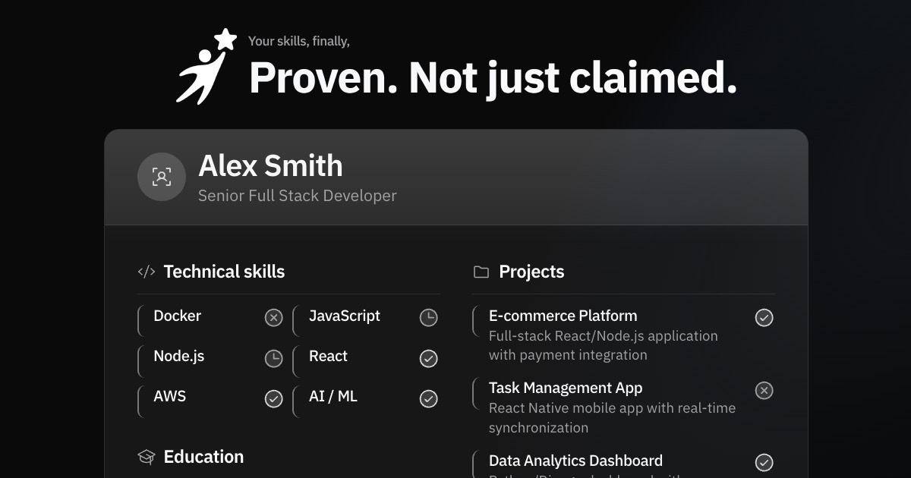

  

  <h1>Skill Verdict</h1>

  
<strong>Your skills, finally — proven, not just claimed.</strong>

  
Skill Verdict turns claimed skills into evidence. Build a living profile, get endorsed by domain experts in short practical reviews, and let opportunities come to you.

  

    <a href="https://app.skillverdict.com"><strong>Get Started</strong></a>
    ·
    <a href="https://app.skillverdict.com/#how-it-works"><strong>See How It Works</strong></a>
  

---

## Contents

- [The problem](#the-problem)
- [How it works](#how-it-works)
- [What you get](#what-you-get)
  - [For candidates](#for-candidates)
  - [For expert reviewers](#for-expert-reviewers)
  - [For the Skill Verdict team](#for-the-skill-verdict-team)
- [Layouts](#layouts)
- [Built to scale](#built-to-scale)
- [On the roadmap](#on-the-roadmap)
- [Tech stack](#tech-stack)
- [For the team](#for-the-team)

## The problem

Every CV claims the same things. "Expert in React." "Strong communicator." "5 years of Python." None of it is checked, so hiring teams fall back on proxies — brand names, job titles, referrals — and spend weeks re-testing skills that candidates already have.

Candidates lose too. Good people get filtered out by keyword matching before anyone looks at what they can actually do, so they spend their time chasing applications instead of being found.

Skill Verdict fixes the missing layer: independent, expert-reviewed proof of ability, attached to a profile the candidate owns and can share anywhere.

## How it works

1. **Build your profile** — Bring in your experience, projects, and portfolio to create a living, evidence-backed profile.
2. **Pick skills to verify** — Choose the skills you want endorsed and get matched with a domain expert reviewer.
3. **Complete the assessment** — Receive a practical, scenario-based assignment, submit your work, and get real feedback in conversation.
4. **Earn your verdict** — Pass the review to earn a verified skill badge on your profile, visible to anyone you share it with.

Reviews are anonymous. Reviewers assess the work, not the name, the school, or the last logo on the CV.

## What you get

Skill Verdict has three sides, and all three are built: candidates who prove what they can do, domain experts who assess them, and the team that runs the verification pipeline.

### For candidates

**Three kinds of proof — and each one can be shown on your CV.**

- **Skill verification** — Pick a skill, get matched with a domain expert, and complete a practical, scenario-based assessment. A verified skill carries a green check on your CV, and hovering it names the reviewer who signed off and their title.
- **Employment history verification** — Prove a job actually happened with a payslip, a contract, or a freelancer profile link. Once the Skill Verdict team confirms it, a green check appears beside the employer's name on your CV.
- **Identity verification** — Confirm you are who you say you are in a short video call. Approved identities carry a green check beside your name on every layout.

Everything you verify is yours to display or hide. Badges render inline on your CV, an optional Verification History section can list each verdict and who issued it, and any individual badge can be switched off in Privacy settings.

**Your CV**

- Full builder with live preview, 16 section types, drag-and-drop ordering, rich text, and undo/redo
- 13 layouts, with control over typography, color, spacing, page size, and custom CSS
- Publish at `app.skillverdict.com/your-name/your-cv`, protect it with a password, or unpublish in one click
- View and download counts on every public CV
- Export to PDF, DOCX, or JSON — your data leaves with you
- AI assistant that rewrites and restructures any section on request, reviews the whole CV with an action plan, and imports an existing PDF or Word CV into structured data

**Job search**

- Live listings from across the major job boards, filtered by role, location, salary, remote, and employment type
- Tailor your verified CV to any posting in one click before you apply

**Work authorization**

- Record your status for the EU, US, and UK, including sponsorship needs, visa type, and dates
- Attached to your CV for employer matching and shared only with employers after you tick the consent box for that region. It is never displayed on your public CV.

**Account**

- Profile details, language, and theme preferences
- Password, two-factor authentication, and linked sign-in providers
- Permanent account and data deletion on request, no support ticket required

### For expert reviewers

- A dedicated review queue with the candidate's identity withheld, so assessments are judged on the work alone
- Issue an assessment, review the submitted solution, attach supporting documents, and propose a verdict
- A public reviewer profile that appears in the badge tooltip on every CV you have signed off

### For the Skill Verdict team

- **Verification pipeline** — separate queues for pending skill verdicts, employment history evidence, and identity calls
- **People** — user directory with role assignment, plus reviewer onboarding and the skills each reviewer is allowed to assess
- **Configuration** — global AI provider credentials with a connection test, job search API setup, and scoped API keys

## Layouts

Every layout is designed around evidence — verified badges, outcomes, and real work sit above decoration.

<table>
  <tr>
    <td align="center">
      
       <b>Azurill</b>
    </td>
    <td align="center">
      
       <b>Bronzor</b>
    </td>
    <td align="center">
      
       <b>Chikorita</b>
    </td>
    <td align="center">
      
       <b>Ditto</b>
    </td>
  </tr>
  <tr>
    <td align="center">
      
       <b>Gengar</b>
    </td>
    <td align="center">
      
       <b>Glalie</b>
    </td>
    <td align="center">
      
       <b>Kakuna</b>
    </td>
    <td align="center">
      
       <b>Lapras</b>
    </td>
  </tr>
  <tr>
    <td align="center">
      
       <b>Leafish</b>
    </td>
    <td align="center">
      
       <b>Onyx</b>
    </td>
    <td align="center">
      
       <b>Pikachu</b>
    </td>
    <td align="center">
      
       <b>Rhyhorn</b>
    </td>
  </tr>
  <tr>
    <td align="center">
      
       <b>Ditgar</b>
    </td>
  </tr>
</table>

## Built to scale

- **55 languages** — the entire product is localized, not just the marketing pages
- **Works offline** — installable as an app on desktop and mobile, with offline editing
- **Accessible by default** — keyboard navigation throughout, a command palette, and screen-reader support
- **Secure accounts** — two-factor authentication, Google and GitHub sign-in, and enterprise SSO via custom OAuth
- **Open to integration** — a documented API and a Model Context Protocol server let AI agents and internal tools read and update profiles directly

## On the roadmap

- **Passive discovery** — companies search verified skills and reach out to candidates directly, instead of the other way around
- **Personality and culture fit** — research-backed insights alongside verified skills, so teams hire for capability and fit
- **QR sharing** — a unique code that makes your verified profile shareable in person as easily as online

## Tech stack

A single-package, end-to-end TypeScript application — one codebase serves the frontend, the API, and the server runtime.

| Area                 | Technology                                                     |
| -------------------- | -------------------------------------------------------------- |
| Language             | TypeScript (strict)                                            |
| Full-stack framework | TanStack Start (React 19, Vite, Nitro)                         |
| Routing              | TanStack React Router (file-based)                             |
| Server state         | TanStack React Query                                           |
| Client state         | Zustand, with Zundo for undo/redo and Immer for updates        |
| API                  | oRPC (type-safe RPC with a generated OpenAPI spec)             |
| Database             | PostgreSQL with Drizzle ORM                                    |
| Authentication       | Better Auth (OAuth, 2FA, API keys, OAuth provider for clients) |
| Styling              | Tailwind CSS v4                                                |
| UI components        | shadcn/ui on Base UI, Phosphor icons, Motion                   |
| Forms and validation | React Hook Form with Zod                                       |
| Rich text            | Tiptap                                                         |
| AI                   | Vercel AI SDK (OpenAI, Anthropic, Gemini, Ollama)              |
| Agent access         | Model Context Protocol SDK                                     |
| Internationalization | Lingui, 55 locales                                             |
| PDF export           | Puppeteer Core via Browserless                                 |
| File storage         | S3-compatible, with local filesystem fallback                  |
| Toolchain            | Vite+ (Rolldown, Vitest, Oxlint, Oxfmt, tsgo)                  |

## For the team

Setup, environment variables, and the command reference live in [AGENTS.md](AGENTS.md).

---

  
<strong>Don't chase. Attract.</strong>

  
<a href="https://app.skillverdict.com">app.skillverdict.com</a>

  
Copyright © Skill Verdict. All rights reserved. This software is proprietary and confidential.

